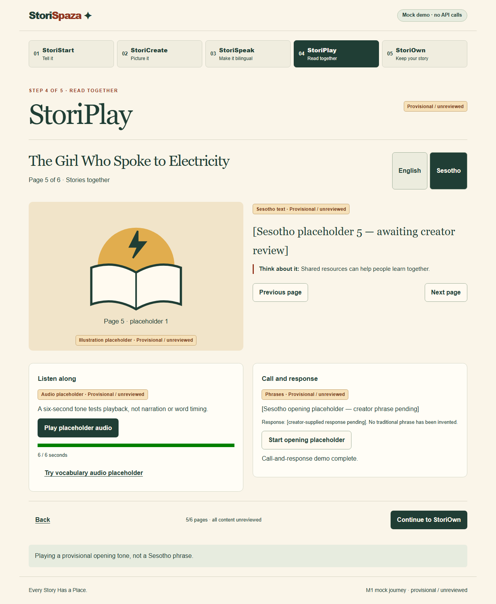

# StoriSpaza

**Every Story Has a Place. Tell It. Create It. Own It.**

A creator-led African storytelling studio for Grade R–3 teachers, parents and families. Planned journey: StoriStart → StoriCreate → StoriSpeak → StoriPlay → StoriOwn. Read the [spec](docs/SPEC.md) and [approved plan](docs/PLAN.md).

## Current status: M1 mock journey

Implemented: all five stages with six editable fixture pages, per-page illustration placeholders/regeneration, editable Sesotho slots, bilingual reader, non-speech audio play/pause/resume, opening/pause/tap-to-continue interaction, demo acknowledgements, browser-local save/restore, consented tone-copy attachment/deletion and provisional JSON/HTML exports. Real generation, real images, reviewed translations and creator narration remain later milestones. M0's server-only provider/storage/budget foundations remain intact.

Open `/studio` for the journey. The first screen explains six-page illustrated bilingual storytelling immediately. Every placeholder text/image/audio/phrase stays visibly **provisional / unreviewed**; checking demo acknowledgements never grants actual language/cultural approval or enables final publication.

**Real-device check: passed, creator-reported.** The creator confirmed successful Android/Chrome airplane-mode checklist completion; model/OS/browser versions and tested-file hash are pending. See the [device test record](docs/MOBILE_OFFLINE_TEST.md) for the distinction between human-reported and automated evidence.

No Sesotho voice-to-story or synthetic Sesotho speech claims. Sesotho requires human review/creator recordings. [Fixtures](fixtures/manifest.json) are not real-generated or human-approved. No recordings are committed.



[Mobile reader screenshot](docs/screenshots/m1-mobile.png). Captured from automated production/standalone browser checks, not physical hardware. [M0 foundation screenshot](docs/screenshots/m0-desktop.png) remains as lifecycle evidence.

First screen: [desktop](docs/screenshots/m1-welcome-desktop.png) · [mobile](docs/screenshots/m1-welcome-mobile.png). Product explanation and Start action are verified in the initial viewport.

## Setup

Use **Node 24.14+ (24.x)**, preferably the `.nvmrc` version, with npm. Node 18.6 found on the development laptop is too old. Select Node 24 with your runtime manager; the project does not change global Node.

On this laptop, the bundled runtime can be selected for the current PowerShell session only:

```powershell
$env:PATH = "$env:USERPROFILE\.cache\codex-runtimes\codex-primary-runtime\dependencies\node\bin;$env:PATH"
node --version
```

Confirm a 24.x version before running npm commands. This bundled path is specific to the Codex desktop environment; other contributors should install/select Node 24 normally.

```sh
npm ci
npm run dev
```

Open http://127.0.0.1:3000. No environment file/key/network needed at runtime in mock mode. Installation requires registry access. Fonts/assets are local. To customize, copy `.env.example` to `.env.local` and keep it ignored.

## Android offline journey

```sh
npm run build:offline
```

Transfer `public/offline/storispaza-offline.html` to the phone's Downloads folder and open it in Chrome. Enable airplane mode and turn Wi-Fi/mobile data off; the full journey is embedded in that one file. No LAN server exposure, account, public hosting or API key is needed after transfer. Build metadata/hash is in `public/offline/build.json`. The generated file is ignored by Git and rebuilt from the same React component used at `/studio`. Both npm run dev (via predev) and npm run build generate the home-page download.

Follow the [real-device checklist](docs/MOBILE_OFFLINE_TEST.md), including audible playback, both downloads, reload/restore and recording-copy deletion. File/content-origin storage and opening behavior vary by browser; errors stay visible rather than silently claiming success. Browser drafts are saved only on explicit consented Save and are not encrypted. Use fictional demo content. Keep JSON/HTML exports as recovery copies.

## Environment and API

| Variable | Default | Purpose |
| --- | --- | --- |
| AI_PROVIDER | mock | Explicit mock/real; unknown values rejected. |
| OPENAI_API_KEY | unset | Server-only; never NEXT_PUBLIC_. Real operations disabled in M0. |
| OPENAI_TEXT_MODEL | gpt-5.6-terra | Planned M2/M4 model, not called in M0. |
| OPENAI_IMAGE_MODEL | gpt-image-2.6-sunburst | Planned M3 default. |
| OPENAI_TRANSCRIPTION_MODEL | gpt-transcribe | Planned English capture. |
| DATA_DIR | ./data | Ignored SQLite/private asset directory. |
| SESSION_BUDGET_USD | 2 | Approved session allowance; may be lowered. |
| DEVELOPMENT_BUDGET_USD | 10 | Development allowance; may be lowered. |
| AI_REQUESTS_PER_MINUTE | 10 | Maximum per-session rate. |
| NEXT_TELEMETRY_DISABLED | 1 in example/CI | Disable Next telemetry, including builds. |

GET /api/health returns readiness/milestone without secrets. GET /api/demo/story returns data/provenance/review status in mock mode; real mode returns 503. No mutation/paid routes. Configuration/ledger are foundation primitives; future routes must integrate them before paid requests. Keep this no-auth app on loopback.

## Checks

```sh
npm run check
npx playwright install chromium
npm run test:e2e
```

Check runs lint, route-type generation/strict typecheck, unit/integration/API tests and production/offline builds. E2E starts a production server at 127.0.0.1:3100, with mock mode/no key and external requests blocked. It covers the five-stage Next.js journey after networking is disabled and the self-contained file loaded from disk with networking disabled from the start, at desktop/mobile sizes. It also verifies playback/storage failure handling. SQLite tests use temporary databases; no paid requests occur in tests/CI. Results and remaining verification limits are in [reviews](docs/REVIEWS.md).

## Local production and reuse

```sh
npm run build
npm start
```

Node server binds to loopback. Hosted deployment/auth/publishing are deferred. See [architecture](docs/ARCHITECTURE.md), [research](docs/DECISIONS.md), [safety](docs/AI_SAFETY.md), [language extension](docs/ADDING_A_LANGUAGE.md), [Codex evidence](docs/CODEX_WORKFLOW.md), [pitch](docs/DEMO_SCRIPT.md), [contributing](CONTRIBUTING.md), and [MIT license](LICENSE). The exact 24 M4 recording filenames/purposes are in PLAN.md; scripts follow finalized text. M7 educator/reviewer feedback is mandatory and not yet collected.
