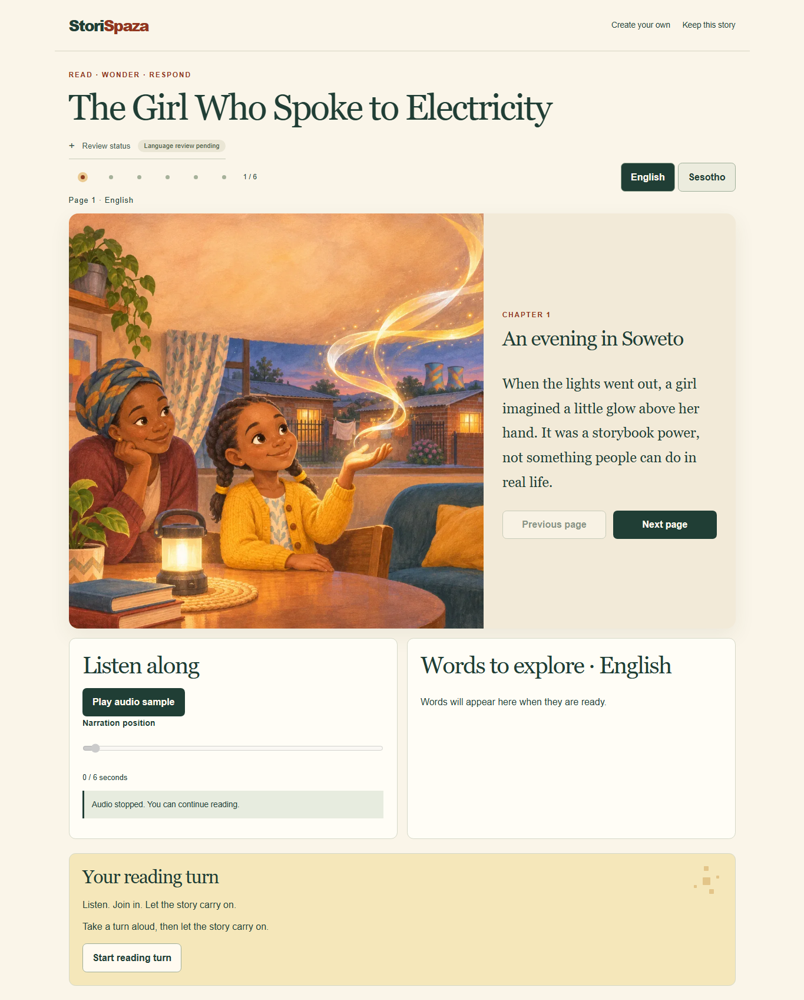

# StoriSpaza

**Every Story Has a Place. Tell It. Create It. Own It.**

A local, creator-led storytelling studio for Grade R–3 teachers, parents and families. Create and edit six-page stories, review English and Sesotho side by side, read together, and decide what leaves your device. The demo, *The Girl Who Spoke to Electricity*, is a fictional Soweto story about curiosity, safe science and community.

**Evaluation status:** M0–M6 implementation is committed; M7 Part A covers documentation and reproducible checks; the visual addendum puts approved art and the reader first, with reduced-motion-aware page turns and response sparks. **M4 content review remains OPEN** while the creator reviews and records. The earlier baseline was 17/24 approved scripts and 2/24 clips; it is not a live progress count. No complete reviewed bilingual/audio fixture pack is claimed. Submission deadline: **11 November 2026, 23:00 SAST**.

## See it



[Mobile reader](docs/design/after-reader-mobile.png) · [Landing cover](docs/design/after-landing-desktop.png) · [Before/after design review](docs/design/README.md) · [English capture/editor](docs/screenshots/m2-desktop.png) · [Mobile editor](docs/screenshots/m2-mobile.png). Screenshots are automated mock/intercepted-fixture demonstrations, not proof of fluent language review, a real microphone result or educational outcomes. The image pack was reviewed separately in M3.

## Features and current boundaries

| Stage | Implemented | What the evaluator should expect |
| --- | --- | --- |
| StoriStart | Six-page editing, real text structuring and consented **English-only** voice transcription with editable transcript/manual fallback | `/create` needs explicitly activated real mode for generation/transcription. `/studio` replays a fixed story and fixture transcript with no microphone/API. |
| StoriCreate | Character sheet, reference-guided illustrations, complete-prompt checks, selective regeneration and per-image review/history | `/illustrate` mock uses labelled solid-colour placeholders. `/studio` replays the seven consented reviewed M3 source images; simulated preview keeps the approved source image unchanged. |
| StoriSpeak | Six English/Sesotho narrative pairs, uncertainty notes/corrections, explicit current approvals, exactly 24 adult recording slots and deletion | `/speak` uses a private browser session. Draft translations are unreviewed; vocabulary and interaction phrases come from the creator. No synthetic speech. |
| StoriPlay | Bilingual navigation, current approved page/vocabulary audio, play/pause/resume/seek, page-level highlighting and tap/keyboard call-and-response | `/play` reads the same session. Missing/unapproved/stale audio stays text-only. Mock audio is a labelled non-speech signal. No child microphone is used. |
| StoriOwn | Attribution, ownership explanation, private/shared manual files, final approval gates, optional narration consent and recording deletion | `/own` blocks incomplete final editions. JSON includes story/provenance/history; standalone HTML embeds reviewed images and optional approved page narration. Raw input recordings and private corrections are excluded. No public URL/gallery. |

The self-contained `/studio` journey is a **provisional rehearsal**; its acknowledgements never approve language/culture or unlock final publication. Its provisional exports differ from M6's guarded final exports. Actual source provenance survives replay and creator edits.

## Stack

One Next.js 16 App Router application, React 19, strict TypeScript 6, Tailwind 4 plus local CSS, Zod 4, Node's built-in SQLite and local files. Vitest covers domain/services/provider contracts; Playwright covers production desktop/mobile and offline journeys. Providers use isolated server adapters with reusable contracts; no accounts, MCP integrations or hosted backend are needed. Dependencies and overrides are pinned in `package-lock.json`.

## Clean-clone quick start

Prerequisites: **Node 24.14+ within 24.x** (the pinned `.nvmrc` is **24.22.1**), npm and Git. Install/select that runtime with your usual runtime manager. Node 18 is unsupported. Installation needs npm registry access; mock application runtime needs no external network or key.

```sh
git clone --branch codex/m7-design-polish <repository-url> storispaza
cd storispaza
node --version
npm ci
npm run dev
```

Use the repository URL supplied with the submission. Before this branch is published, a local clone can use the local repository path as `<repository-url>`. Open [http://127.0.0.1:3000](http://127.0.0.1:3000), choose **Read the story** to open the reader directly, or **Create your own** → **Start the mock journey** → **Load six-page demo story**. No environment file is required in a clean shell. `predev` builds the downloadable offline journey automatically. See [clean-clone validation](docs/CLEAN_CLONE.md) for tested commands and evidence.

For this development laptop only, select the bundled Node without changing the global runtime:

```powershell
$env:PATH = "$env:USERPROFILE\.cache\codex-runtimes\codex-primary-runtime\dependencies\node\bin;$env:PATH"
function npm { & "$env:USERPROFILE\.cache\codex-runtimes\codex-primary-runtime\dependencies\node\bin\node.exe" "$env:APPDATA\npm\node_modules\npm\bin\npm-cli.js" @args }
function npx { & "$env:USERPROFILE\.cache\codex-runtimes\codex-primary-runtime\dependencies\node\bin\node.exe" "$env:APPDATA\npm\node_modules\npm\bin\npx-cli.js" @args }
node --version
npm --version
```

These functions affect only the current PowerShell session and explicitly run the existing npm CLI with Node 24. On this laptop, changing PATH alone leaves a global `npm.cmd` that launches its adjacent Node 18, even when `node --version` says 24. When using the functions, quote a forwarded separator, for example `npm start '--' --port 3600` or `npm run verify:public '--' --staged`; PowerShell otherwise consumes the unquoted `--` before forwarding it. Other contributors should select a matching Node/npm installation with their runtime manager; do not copy these machine-specific paths.

Do not copy the creator's `.env.local`, `data/`, `.tools/` or browser profile into an evaluator checkout. If inherited shell variables select real mode, set `AI_PROVIDER=mock` and `ENABLE_LIVE_AI=0` for the evaluation process. Keep existing personal configuration and the recording server unchanged.

## Mock mode and offline use

At `/studio`, load the fixed six-page story, edit a page, move through the five named stage tabs, toggle the bilingual slots and try playback/response. One small badge and a collapsible **Review status** panel preserve current review/mode/audio/provenance disclosure; acknowledgements never become real content approval. Real M3 image sources are separately attributed; preview requests keep those approved source images in place. No API call, credential or internet connection is needed after loading the journey.

```sh
npm run build:offline
```

Transfer `public/offline/storispaza-offline.html` to Android Downloads and open it in Chrome, then disable Wi-Fi/mobile data. It contains code, images and a generated non-speech signal in one file. `public/offline/build.json` records its size/hash. Generated bundles are ignored, not committed. File-origin save/download/audio behavior varies; errors stay visible. The creator reported an Android/Chrome airplane-mode check of the earlier journey; exact device/version/hash details remain pending in [the device record](docs/MOBILE_OFFLINE_TEST.md). That is distinct from automated mobile emulation or testing the new M6 reader.

`/play` and `/own` use the local server for the private M4 workspace. An approved `/own` HTML export opens offline by itself; final export remains blocked until its actual required content approvals are current. See [StoriOwn instructions](docs/M6_STORIOWN.md).

## Environment variables and real mode

All variables are server-side; never prefix credentials with `NEXT_PUBLIC_`. `.env.example` contains blank credentials and safe mock defaults. Copy it to ignored `.env.local` only in a new checkout; do not overwrite existing creator configuration. Real mode is optional, paid, and outside the key-free evaluation path.

| Variable | Default / limit | Purpose |
| --- | --- | --- |
| `AI_PROVIDER` | `mock` | Explicit `mock` / `real`; invalid modes fail. |
| `AI_ADAPTER` | unset; example `openai` | Select a registered adapter in real mode; no silent fallback. Cloudflare remains deferred. |
| `ENABLE_LIVE_AI` | `0` | New live provider requests require `1` plus mode, access and consent. Existing review can stay available with live generation disabled. |
| `OPENAI_API_KEY` | blank | Selected adapter's secret; ignored `.env.local` only. |
| `OPENAI_TEXT_MODEL`, `OPENAI_IMAGE_MODEL`, `OPENAI_TRANSCRIPTION_MODEL` | pinned defaults in `.env.example` | Adapter model choices. Changes require revised pricing/access tests, not arbitrary substitutions. |
| `DATA_DIR` | `./data` | Ignored, unencrypted SQLite/private workspace files. Use a separate directory for testing. |
| `SESSION_BUDGET_USD` | `2`, may only be lowered | Durable per-session app allowance. |
| `DEVELOPMENT_BUDGET_USD` | `10`, may only be lowered | Shared development allowance; uncertain reservations remain held. |
| `AI_REQUESTS_PER_MINUTE` | `10`, may only be lowered | Per-session request cap. |
| `IMAGE_ATTEMPT_LIMIT` | `20`, may only be lowered | Includes sheet, pages, failures, ambiguous dispatches and regenerations across sessions. |
| `NEXT_TELEMETRY_DISABLED` | `1` in example/CI | Disable framework telemetry, including build. |

For separately authorized real operations, set real mode, the selected adapter, its local key and explicit activation; restart the server on loopback and use `/create`, `/illustrate`, `/speak`. Each operation has additional app consent/review gates. [Provider switching](docs/SWITCHING_PROVIDERS.md) and [decision evidence](docs/DECISIONS.md) document the adapters and bounded historical probes. Costs are rate-derived estimates/measurements, not verified invoices. App caps cannot account for external account spend. No paid command or fixture-freeze runner is part of this quick start.

## Tests and public evaluation checks

```sh
npm run check
npm run verify:public
npx playwright install chromium
npm run test:e2e
```

`check` runs lint, route type generation/strict TypeScript, unit/integration/API tests and production/offline builds. Run it before E2E: unit tests prepare an ignored synthetic M6 offline-reader artifact used by browser checks. On Linux CI, use `npx playwright install --with-deps chromium` if OS dependencies are absent. Test servers bind to loopback ports **3100/3200** with blank API keys; make those ports available. Browser installation needs network; test application flows use fixtures/intercepted transports and make no paid requests. Microphone tests use Chromium's fake device, not the creator's voice. Databases use temporary or `data/e2e-images` locations, not the active review workspace.

The public scanner checks current tracked/nonignored files and existing browser/offline build assets for private paths, known credential patterns and matching local credential values without printing values. `npm run verify:public -- --staged` checks the full Git index before commit. It deliberately rejects audio/speech-fixture commits while M4 is open. It is a heuristic current-tree check, not a full Git-history or third-party security audit. A previously exposed key was revoked/replaced by creator confirmation; see [security evidence](docs/AI_SAFETY.md). Never share an old credential, even if revoked.

Paid tests are opt-in, disabled by default and excluded from hosted CI. Do not enable `RUN_PAID_TESTS`, translation/image measurement runners or `FREEZE_REVIEWED_SPEECH` for evaluation. Remaining human approval/consent cannot be supplied by test flags. [Review results and limits](docs/REVIEWS.md) distinguish mock mechanism coverage from actual content acceptance.

## Deployment: local production only

```sh
npm run build
npm start
```

Open [http://127.0.0.1:3000](http://127.0.0.1:3000). The provided scripts bind to `127.0.0.1`; keep this no-account app on loopback. Do not expose it with `0.0.0.0`, tunnels, cloud hosts or a LAN port forward. There is no public story URL, gallery or authentication system. For a phone demonstration, transfer the standalone HTML instead. Persist private data only in your ignored local directory; exported copies/backups cannot be remotely recalled.

## Known limitations / Future work

- **No Sesotho speech recognition or text-to-speech.** Voice-to-story capture/transcription is English-only and experimental; Sesotho uses typed text, human-reviewed draft translation and consenting adult creator recordings. No voice cloning or child-response recording/recognition.
- **M4 is incomplete.** Actual language/science/cultural review, missing creator vocabulary/interaction wording, remaining recordings and final redistribution/freeze consent remain human work. Missing audio stays text-only; unapproved content stays labelled. No complete speech fixture pack is committed.
- `/create`, `/illustrate` and `/speak` are separate milestone workspaces. StoriSpeak's demo review starts from the fixed demo English source; a general arbitrary-story handoff is deferred. Do not claim a fresh live idea automatically flows end to end through every stage.
- Mock generation is fixed replay, not live AI. M6 final export currently embeds known consented image-pack assets; unknown images block export. Its simple HTML omits vocabulary/interaction audio. ZIP/PDF/EPUB, arbitrary-word pronunciation, exact word timing, collaboration, accounts, public hosting/gallery and additional language packs are deferred.
- The reader highlights a whole passage, not exact words. Reduced-data preloading is a browser hint. Physical-device/screen-reader validation of new M5/M6 flows and real noisy/accented English capture remain limited/unverified.
- Local SQLite/browser storage is unencrypted; deletion is logical and does not erase WAL/backups/provider-held data or already exported copies. Cultural correctness, copyright/exclusivity, identity consistency and educational improvement are not guaranteed by AI or schemas.
- Teacher/parent feedback, final pitch rehearsal and backup recording are pending. [Feedback template](docs/EDUCATOR_FEEDBACK_TEMPLATE.md) is blank; it is not collected evidence. Hosted CI results are separate from local checks.

## Reuse, licence and evidence

Code and documentation use the [MIT licence](LICENSE). Reviewed images have separate [creator review/redistribution consent and provenance](fixtures/approved-images/CONSENT.md); provisional text is not language-certified. There is no blanket licence to private recordings or third-party contributions. See [Contributing](CONTRIBUTING.md), [architecture](docs/ARCHITECTURE.md), [adding a language](docs/ADDING_A_LANGUAGE.md), [provider contracts](docs/SWITCHING_PROVIDERS.md), [safety/data lifecycle](docs/AI_SAFETY.md), [Codex lifecycle examples](docs/CODEX_WORKFLOW.md) and the [four-minute pitch/backup plan](docs/DEMO_SCRIPT.md).
